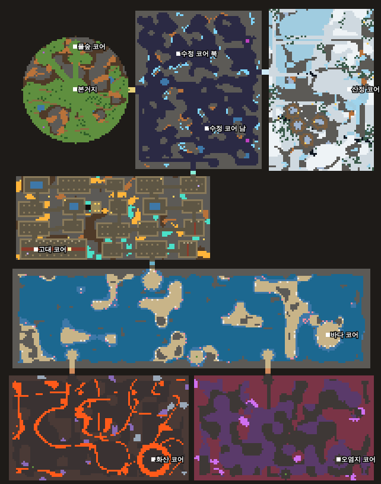
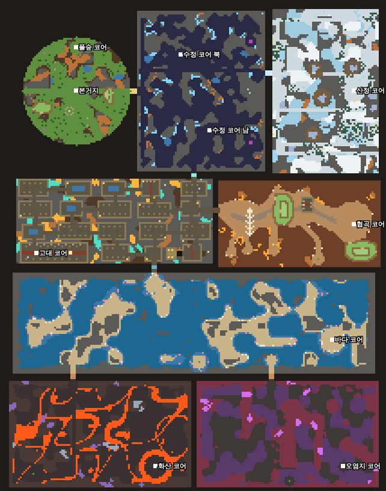

# 봉인 너머 — 지도 설계 문서

v41에서 처음 쓴다. 이 문서는 세계를 어떻게 배치하는지 정해 두는 문서다. 새 바이옴을 넣거나 지도를 고칠 때는 여기 원칙을 먼저 따른다. 원칙을 바꿔야 하면 이 문서부터 고친다.

## 1. 원칙 (사용자 확정, v39)

세계의 큰 틀은 본거지를 가운데 둔 동심원이다. 본거지에서 멀어질수록, 즉 바깥 고리로 갈수록 어려워진다. 고리 하나에는 같은 난이도대의 지역이 여럿 나란히 놓일 수 있고, 같은 고리 안에서 무엇을 먼저 갈지는 플레이어가 고른다.

큰 틀은 동심원이지만 바이옴 하나하나의 모양까지 둥글 필요는 없다. 사원은 직각 격자, 동굴은 부정형 덩어리, 협곡은 길게 굽은 골짜기처럼 모양은 바이옴마다 따로 정한다. 옆 지역에 붙어 있는 바이옴이 있어도 된다. 동심원이 정하는 것은 어디에 있느냐(거리와 방향)이고, 생김새는 정하지 않는다.

거리는 두 가지로 잰다. 직선 거리는 지도에서 고리를 그릴 때 쓰고, 걸어서 닿는 거리(봉인을 다 열었다고 치고 본거지에서 걸어서 세는 칸 수)는 실제 체감 난이도와 귀환·순간이동이 얼마나 필요한지를 판단할 때 쓴다. 두 값이 모두 진행 순서대로 커져야 원칙을 지킨 것이다.

## 2. 지금 지도 진단 (v40, 시드 12345)

지금 지도는 동심원이 아니라 상자들을 사슬처럼 이은 구조다. 본거지가 있는 평원은 214×272 지도의 왼쪽 위 구석에 있고, 동굴은 그 동쪽, 사원은 동굴 아래, 숨은 바다는 그 아래, 하드모드 화산·오염지는 맨 아래에 있다. 고산만 동굴 동쪽에 따로 붙어 있다.

본거지에서 각 코어까지 거리를 재면 다음과 같다(직선 → 걸어서).

- 풀숲 코어 24 → 22
- 수정 코어 북 61 → 112, 수정 코어 남 77 → 134
- 고대 코어(사원) 93 → 409
- 산정 코어(고산, 하드모드 갈래) 154 → 206
- 바다 코어 198 → 444
- 화산 코어 213 → 505, 오염지 코어 255 → 522

드러나는 문제는 넷이다.

첫째, 본거지가 가운데가 아니다. 본거지 서쪽과 북쪽은 처음부터 끝까지 기반암이다. 그래서 밤 습격이 거의 한쪽에서만 오고, 영역을 넓히는 방향도 동쪽과 남쪽뿐이다. 원래 의도는 사방으로 넓혀 가는 거점 게임이다.

둘째, 진행 순서와 거리가 맞지 않는다. 하드모드 갈래인 고산(걸어서 206)이 그보다 앞 단계인 사원(409)과 숨은 바다(444)보다 훨씬 가깝다. 지금은 얼음벽이라는 열쇠로만 막고 있다. 열쇠로 막는 것 자체는 괜찮지만, 플레이어가 바로 옆에 있는 어려운 지역을 보면서 먼 쉬운 지역으로 돌아가게 만든다.

셋째, 사원이 걸어서 409칸으로 직선 거리(93)의 네 배가 넘는다. 미로 사원에 들어가려면 먼저 동굴 남쪽 끝까지 돌아가야 하기 때문이다. 귀환(H)과 승강석이 이 거리를 메우고 있다.

넷째, 모든 바이옴의 바깥 테두리가 곧은 직사각형 기반암이다. 안쪽 모양은 바이옴마다 다르지만 테두리는 다 같아서, 지도 전체로 보면 상자들을 늘어놓은 모양이다.

## 3. 목표 배치 (제안, 아직 구현 안 함)

목표는 본거지를 지도 한가운데 두는 것이다. 지도는 약 300×300 칸으로 넓히고(지금 58,208칸 → 90,000칸), 본거지를 (150,150)에 둔다. 고리는 다섯 개다.

- 0고리(반지름 0~30): 평원 본거지. 지금 평원 그대로.
- 1고리(30~60): 수정 동굴과 풀숲. 동굴은 평원을 반쯤 감싸는 초승달 모양 덩어리로 바뀐다. 첫 봉인은 평원과 1고리 경계에 여러 개 생길 수 있다.
- 2고리(60~95): 사원, 화석 협곡, (나중에) 고치 동굴. 같은 고리라서 순서는 자유다. 사원만 제단이 있어 필수고, 나머지는 선택 바이옴이다.
- 3고리(95~125): 숨은 바다. 지도를 거의 한 바퀴 두르는 내해로 만든다. 바다 하나를 건너야 바깥 고리로 갈 수 있다는 그림이 분명해진다.
- 4고리(125~150): 하드모드 세 갈래. 고산·화산·오염지가 부채꼴 세 조각을 나눠 갖는다.

고리 사이를 넘을 때 봉인이나 열쇠가 걸리고, 같은 고리 안에서 옆 칸으로 갈 때는 지형(얼음벽, 용암, 깊은 물)이 막는다. 균열(적이 나오는 곳)은 늘 그 지역 바깥쪽 가장자리에 둔다. 그러면 적은 바깥에서 안쪽 본거지로 밀려 들어오고, 플레이어는 안에서 바깥으로 밀고 나가는 그림이 된다.

### 전환 방법

한 번에 다 바꾸지 않고 순서대로 바꾼다.

1. 각 바이옴 생성 함수가 지금은 `CONFIG.xxx`의 직사각형(x0~x1, y0~y1)을 받는다. 이것을 `sectorMask(고리, 시작 각, 끝 각)`가 돌려주는 칸 집합을 받도록 바꾼다. 안쪽 생성 논리(셀룰러 오토마타, 격자 방, 능선 노이즈)는 그대로 둔다.
2. 코어·보스·균열·입구 좌표는 고정 숫자 대신 고리와 각도로 계산한다. 테스트도 `__seal.CONFIG`에서 좌표를 읽고 있으니 같이 따라온다.
3. 저장 형식을 올린다(SAVE_VER 8). 맵 크기가 바뀌어 예전 저장은 못 쓴다.
4. 마지막에 걸어서 거리를 다시 재서 진행 순서대로 커지는지 테스트로 묶는다.

이 전환은 생성 코드 전체를 건드리는 큰 리팩터링이다. 바이옴을 더 넣을수록 고칠 고정 좌표가 늘어나므로, 화석 협곡 다음 바이옴(고치 동굴)을 넣기 전에 하는 것을 권한다. 언제 할지는 사용자가 정한다.

## 4. 지금 지도에 화석 협곡을 넣는 자리 (v41)

전환 전이라서 화석 협곡은 지금 지도의 빈자리에 넣는다. 사원 동쪽, 고산 아래에 비어 있던 기반암 땅(x 122~210, y 100~147)이다. 입구는 사원 동쪽 가운데 줄 방에서 동쪽으로 뚫린 굴이고, 굳은 퇴적층으로 막혀 있어서 수정 곡괭이가 있어야 캔다. 그러니 사원 봉인을 연 뒤에만 들어간다.

진행 단계로는 사원과 같은 2고리다. v41 지도(테스트 하네스 기본 시드)에서 걸어서 거리를 재면 수정 코어 남 116, 협곡 코어 282, 고대 코어 305, 바다 코어 362다. 협곡이 사원과 숨은 바다 사이에 들어가므로 순서가 맞는다. 목표 배치로 옮길 때는 사원 옆 부채꼴로 간다.

협곡 안의 고유 규칙은 두 가지다. 밤이 되면 골짜기 가운데 마른 강바닥에 물이 차서 플레이어와 지상 적이 모두 느려진다(물 위와 같은 0.6배). 그리고 단 위 포탑은 사거리가 1칸 길다. 둘이 합쳐져서, 밤에는 강바닥을 피해 메사와 계단식 단을 거점으로 삼게 된다.

협곡은 선택 바이옴이다. 제단 조건(모든 코어 연결)에 들어가지 않고, 큰 목표 줄(QUESTS)에도 끼어들지 않는다. 협곡 안에 서 있을 때만 목표 줄이 협곡 단계를 보여 준다.

## 5. 입체 구조물 문법 (프리팹)

절벽을 노이즈로 아무 데나 긋던 시제품(v34 `genCliffs`)은 v41에서 없앴다. 그 대신 미리 만든 조각(프리팹)을 배치 규칙에 따라 찍는다.

조각은 글자 격자로 적는다. 한 글자가 한 칸이다. 정해진 글자는 이렇다.

- `.` 건드리지 않음(조각 모양을 직사각형이 아니게 만들 때)
- `_` 그 구역 바닥(평원이면 풀, 협곡이면 협곡 바닥)
- `#` 그 구역 벽
- `1` 1층 단 윗면, `2` 2층 단 윗면(걸을 수 있는 높은 땅)
- `C` 절벽(단 가장자리, 막힘)
- `S` 계단(단을 오르내리는 유일한 길)
- `T` 석상, `A` 작은 제단(장식), `X` 유물 상자, `W` 고대 벽돌, `K` 카펫, `B` 화석 뼈(캘 수 있음), `M` 호박 광맥, `R` 잔해

절벽 칸은 아래(남쪽) 칸이 자기보다 낮을 때만 앞면을 그린다. 그래서 조각을 돌리거나 뒤집어도 따로 그림을 만들 필요가 없다. 높이 순서는 평지 < 1층 < 2층이다.

배치 규칙은 조각마다 데이터로 붙인다.

- 놓일 수 있는 구역과 개수, 같은 조각끼리 최소 간격
- 덮어도 되는 바닥 종류(덮을 칸이 하나라도 다른 종류면 그 자리는 건너뜀)
- 피해야 할 점(코어, 균열, 입구, 보스 자리)과 그 거리
- 돌리기·뒤집기 허용 여부
- 찍은 뒤 검사: 구역 입구에서 지정한 점(코어·균열·보스)까지 여전히 걸어서 닿는지, 그리고 계단이 낮은 땅 쪽 바닥과 이어지는지. 아니면 찍은 칸을 모두 되돌린다.

높은 땅에는 실제로 쓸모가 있다. 1층이나 2층 단 위의 포탑은 사거리가 1칸 늘어난다(고지대). 지상 적은 계단으로만 올라오므로, 단과 계단은 자연스러운 길목이 된다.

v41에서 쓰는 조각은 평원의 작은 언덕 단 두 종류, 길가 석상 한 쌍, 작은 제단, 그리고 협곡의 큰 메사(2층), 계단식 단, 화석 갈비뼈, 무너진 신전이다. 새 조각은 `PREFABS` 표에 글자 격자 하나와 규칙 몇 줄만 더하면 된다.

## 6. 지역 이름 카드

어느 구역에 처음 들어가면 화면 위에서 4분의 1쯤 내려온 가운데에 지역 이름 카드가 4.2초 동안 크게 뜬다. 카드에는 고리 표시("2고리 · 선택 지역"), 이름, 한 줄 설명이 들어간다. 같은 구역에 다시 들어가면 이름만 작게 2.2초 뜬다. 경계를 스치기만 할 때 깜박이지 않도록, 새 구역에 0.7초 머문 뒤에야 들어간 것으로 친다. 이름과 문구는 `REGIONS` 표 한 곳에서 읽는다. 처음 들어갈 때 뜨던 가운데 큰 제목("사원 아래 — 숨은 바다" 같은 것)은 카드와 겹쳐서 없앴다.
